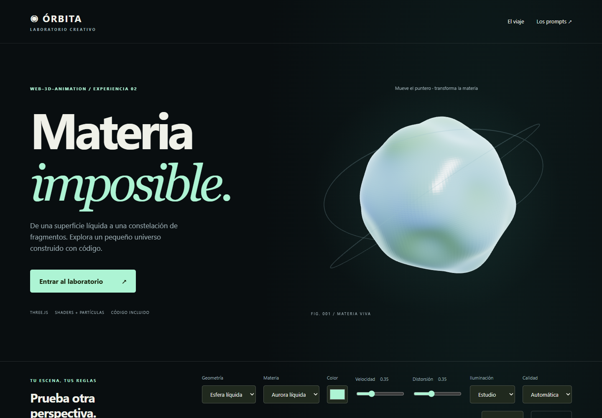

# Web 3D Animation

Habilidad para crear experiencias 3D con Three.js y React Three Fiber: portadas animadas, escenas interactivas, partículas, shaders, modelos GLTF y animación vinculada al desplazamiento.

Incluye **Órbita — Materia imposible**, una demo completa con recursos generados mediante código y seis prompts para recrear sus efectos.



## Instalar en Codex

Pega en Codex:

> Instala la habilidad del repositorio https://github.com/AndrewUru/web-3d-animation, ubicada en skills/web-3d-animation.

También puedes descargar [web-3d-animation.skill](downloads/web-3d-animation.skill), adjuntarlo a Codex y pedir que lo instale.

Una vez instalada, úsala así:

> Usa $web-3d-animation para crear una portada con una escultura líquida, iluminación de entorno y controles de color y velocidad. Usa HTML y Three.js; respeta movimiento reducido y añade una alternativa sin WebGL.

## Ejecutar la demo

Descarga o clona el repositorio y ejecuta desde su carpeta raíz:

```sh
python -m http.server 8000 --bind 127.0.0.1 --directory examples/orbita
```

Abre http://127.0.0.1:8000. Requiere Python 3 y un navegador moderno con WebGL 2. También sirve cualquier servidor HTTP estático. No abras el HTML directamente con doble clic.

La demo incluye Three.js 0.186.1 localmente: no necesita npm ni assets externos para ejecutarse.

## Qué incluye

- Escultura con deformación e iridiscencia mediante shaders GLSL.
- Configurador de cuatro geometrías, tres materiales, color, iluminación, distorsión y velocidad.
- Historia de tres capítulos con cámara y fragmentación vinculadas al scroll.
- Hasta 480 fragmentos instanciados y 12 000 partículas que forman una galaxia.
- Seis prompts copiables, con explicaciones de cada técnica.
- Calidad móvil, pausa global, movimiento reducido y alternativa estática.

Consulta la [guía de la demo](examples/orbita/README.md) y las [instrucciones de la habilidad](skills/web-3d-animation/SKILL.md).

## Estructura

```text
skills/web-3d-animation/  Habilidad, referencias y plantilla
examples/orbita/         Demo completa y guía en español
downloads/              Paquete .skill original
```

## Validación

La demo se comprobó en Chromium con renderizado por software: controles, shaders, scroll, portapapeles, ancho móvil, movimiento reducido y pérdida simulada de contexto, sin errores de consola. No se ha validado en Safari/iOS ni dispositivos físicos. El rendimiento depende del dispositivo.

## Dependencias

Three.js se distribuye bajo licencia MIT; la licencia se conserva en [vendor/LICENSE](examples/orbita/vendor/LICENSE). La habilidad original se incluye sin modificaciones.
